<div align="center">

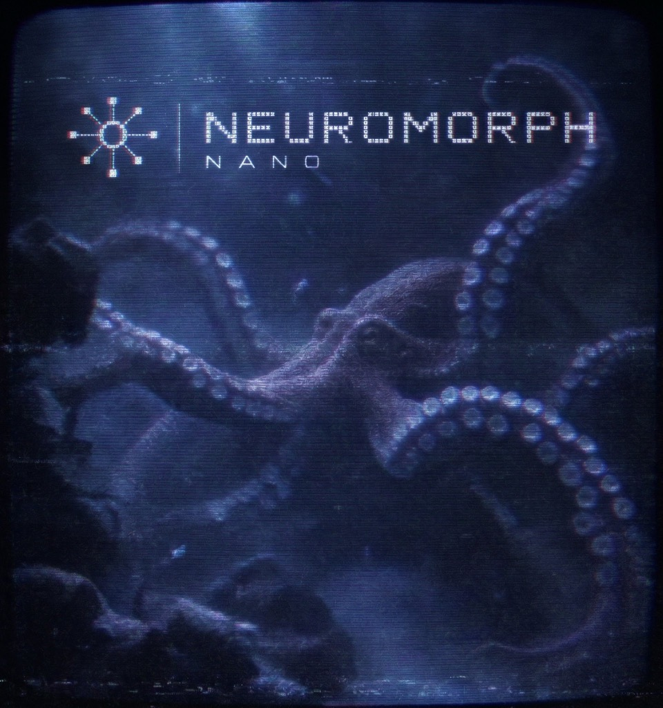

# Neuromorph Nano

**A local cognitive symbiont for coding agents.**

*Give Claude Code, Cursor, VS Code, Antigravity, or Windsurf a local nervous system, persistent memory, and sub-3-second cited codebase recall, running entirely on your own machine.*

[](CHANGELOG.md)
[](crates/)
[](kernels/)
[](https://huggingface.co/gavriel-tech/neuromorph-nano-cartridges)
[](docs/privacy.md)
[](LICENSE)

[A Cognitive Symbiont](#a-local-cognitive-symbiont) · [Architecture](#anatomy-of-the-organism) · [Modular Cartridges & Continual Learning](#modular-parameter-cartridges--preventing-catastrophic-forgetting) · [Parameter Mapping & Editing](#precision-parameter-mapping-surgery--live-editing) · [Features](#complete-feature-set) · [Requirements](#release-status-hardware-and-system-requirements) · [Quickstart](#quickstart) · [Cartridge Library](https://huggingface.co/gavriel-tech/neuromorph-nano-cartridges) · [The Interface](#the-local-interface) · [Privacy & Air-Gap](#privacy-air-gap-and-user-control) · [License](#license-and-copyright)

</div>

---

## A Local Cognitive Symbiont

**Neuromorph Nano** is built on **mutualistic symbiosis** with your coding agent and your hardware.

It does not compete with frontier LLMs, get in the way of your workflow, or burn cloud tokens on repetitive repo searches. It yields the GPU in under 300 ms when interactive work arrives, releases idle KV buffers automatically, obeys hard VRAM, RAM and CPU caps you set, keeps every byte on your disk, and lets you plug in, unplug or remove any learned cartridge cleanly.

Three biological analogies capture how it works:

- **A Symbiotic Nervous System (how it pairs with frontier models):** Think of a frontier LLM (Claude, GPT, Gemini) as a brilliant **prefrontal cortex** in the cloud: exceptional at reasoning, planning, and writing, yet blind to your repository until you spoon-feed it files every session. Neuromorph Nano acts as its local **peripheral nervous system, hippocampus, and cerebellum**, sensing your repository in parallel, remembering verified outcomes across sessions, and turning repeated wins into fast reflexes.
- **An Octopus-Like Distributed Anatomy (how it thinks internally):** An octopus keeps roughly two-thirds of its neurons in its arms rather than in one central brain. Neuromorph Nano distributes intelligence the same way: **Neuropod tentacles and drones** forage your files in parallel, the **Globalized Context Stack (GCX)** carries distilled signals upward across a strict sensory boundary, and one **Core Brain** coordinates four small MicroModels named by their role (**Reader**, **Writer**, **Embedder**, **Reranker**) plus **muscle memory**.
- **Mycorrhiza in Your Codebase (how it lives in a repo):** In a forest, a tall tree has canopy power while a mycorrhizal network lives quietly in the soil, mapping nutrient pockets and delivering concentrated supply on demand. While you are idle, Neuromorph Nano's Writer quietly builds a **4-level world model** (`Piece -> File -> Module -> System`) of your repository so your agent receives small, exact, cited context packs instead of brute-force greps.

---

## Anatomy of the Organism

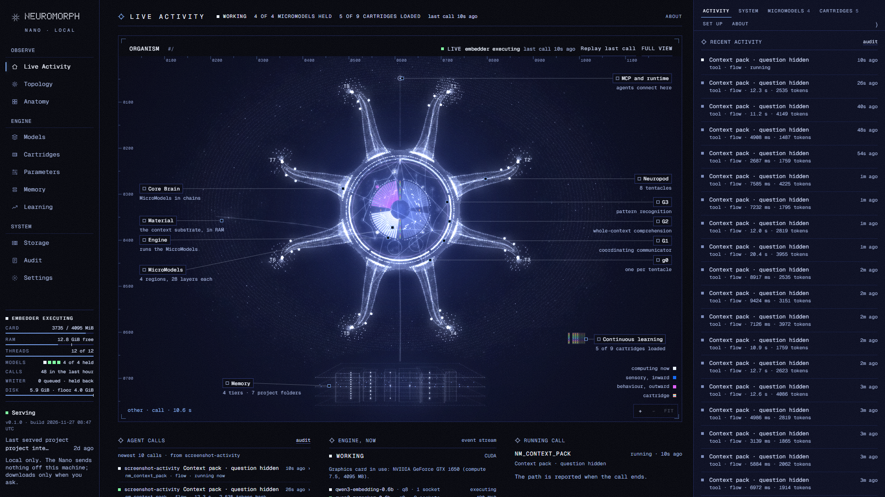

*Live Activity captured at 1920x1080 during a real MCP context-pack call with all four MicroModels resident.*

The full flow, the engine crates and the memory layout are in [docs/architecture.md](docs/architecture.md).

### Why Four Coexisting MicroModels Beat One Monolith Here

Instead of loading one slow giant model for every operation, Neuromorph Nano runs four specialized MicroModels, each seated on its own **base cartridge**, side by side inside a compact local GPU or CPU budget that scales dynamically with your hardware. Removable **job filters** (`nmengn-sockets/1`), **project embedder lenses**, **preference cartridges** and **learned units** plug in on top of them.

| MicroModel | Job | Upstream open weights it is built from |
|---|---|---|
| **Reader** | Reads for the drones and tentacles | `Qwen/Qwen3-0.6B` |
| **Writer** | Writes the world model notes at idle | `Qwen/Qwen3-1.7B` |
| **Embedder** | The meaning index and recall by meaning | `Qwen/Qwen3-Embedding-0.6B` |
| **Reranker** | Ranks and judges close candidates | `Qwen/Qwen3-Reranker-0.6B` |

> **Base cartridges and optional upstream open weights:** A MicroModel is named by its role; the `qwen3-*` ids are the upstream open weights it was built from, not the MicroModel. **Neuromorph Nano runs directly on its four base cartridges (about 6.5 GB)** plus the small tokenizer/config JSONs (about 44 MB). The full upstream Qwen3 open weights (about 8 GB, Apache-2.0) are **optional**: kept read-only when installed, and used for fallback (switching a role to `open`), output-parity reference checks, parameter mapping, and cartridge surgery. Want to contribute base cartridges, parameter maps or mapping techniques? See the [cartridge and parameter contributor protocol](CONTRIBUTING.md#contributing-weight-cartridges-parameter-maps-and-techniques).

| Organ | Role in the Organism | Built-in Safeguard |
|---|---|---|
| **Neuropod (Tentacles + Drones)** | Parallel foraging across code, Markdown, PDFs, CSV/TSV, HTML/XML/JSON/YAML, logs, and zip/tar/Office containers | Read-only sensory access; handles mixed encodings and unseen languages without crashing |
| **GCX (Spinal Cord)** | Carries distilled features and spans upward and control signals downward, in RAM | Enforces the `nmtype::class` sensory boundary so raw code never enters learned state |
| **Core Brain (`G0 -> G1 -> G2 -> G3`)** | Routes intent (`G0`), searches dense, lexical and tree priors (`G1`), runs tentacle reads and close-duel reranking (`G2`), and packs cited spans (`G3`) | Withholds an answer instead of guessing when nothing in the workspace supports it |
| **Idle Writer & World Model** | Uses quiet moments to write `L1 Piece -> L2 File -> L3 Module -> L4 System` notes (L4 is the project outline) | Yields to every interactive query (`< 300 ms` ceiling) |
| **Memory & Muscle Memory** | Stores verified per-repo episodes, tiered memory (`core / active / archive`), and compressed behavioural reflexes | Behaviour only, never copied code; every learned cartridge, unit or filter can be plugged in, unplugged or removed |
| **Local Interface** | 11 pages at `http://127.0.0.1:4870/`: live activity, topology, anatomy, MicroModels, cartridges, parameter maps, memory, learning, storage, audit and settings | No telemetry, no outside requests of its own, and one-switch Air-Gap Mode |

---

## Modular Parameter Cartridges & Preventing Catastrophic Forgetting

Traditional continuous learning fine-tunes one monolithic weight file in place: teaching a model a new codebase, task, or preference overwrites the parameters that carried earlier skills (**catastrophic forgetting**).

**Neuromorph Nano uses a modular weight-separation and cartridge-stacking architecture developed at Gavriel Technologies.** A MicroModel's fixed neural assembly (attention, feed-forward, norm, and readout structure) is cleanly separated from its weights and specializations. Instead of mutating one giant checkpoint, weights and learned parameters are stored as **modular, hash-verified cartridges** that stream in a deterministic authority stack on top of a frozen base cartridge:

```text
  Fixed MicroModel Assembly (Reader / Writer / Embedder / Reranker)
    |
    +-- 1. Base Cartridge             [tensors]   Frozen foundation cut & restored for the role's jobs
    +-- 2. Hardware Settings          [settings]  Per-GPU precision, batching, and residency budgets
    +-- 3. Adapters & Project Lenses  [low-rank]  Unmerged y += scale * up(down(x)) per repository
    +-- 4. Job Filters & Compensation [affine]    f64-folded y = x * gain + bias at named sockets
    +-- 5. Learned Units              [units]     Compartmentalized continual learning (nano / shared / project)
    +-- 6. Preference Cartridges      [prefs]     Always plugged last: user rules, wants, and style
```

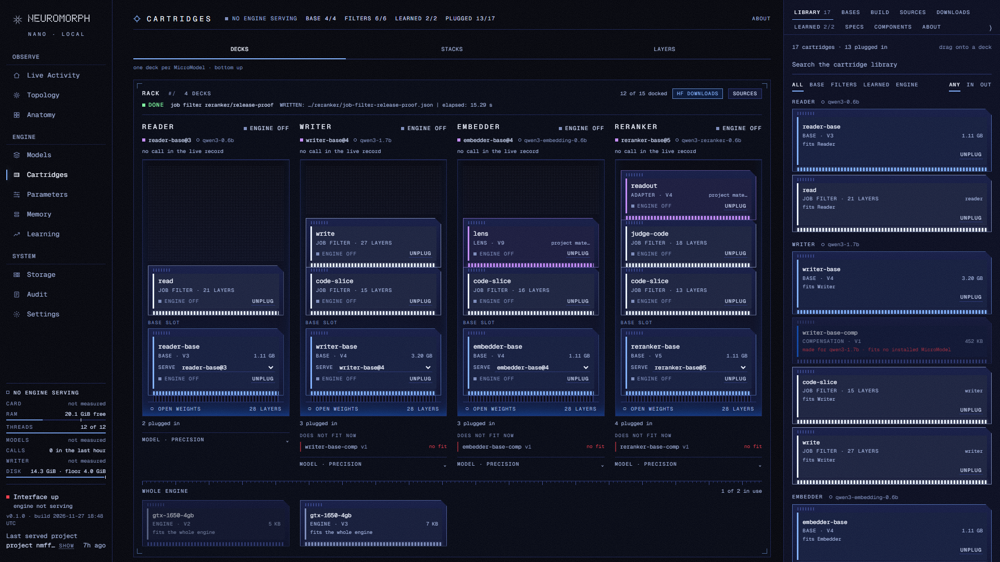

*The 4-deck Cartridge Rack: each MicroModel's base cartridge seats in its base slot with modular job filters, project lenses, and adapters stacked unmerged on top, plus whole-engine hardware cartridges below.*

### How Cartridge Stacking Prevents Catastrophic Forgetting

- **Base parameters stay frozen during continual learning:** Base cartridge creation is strictly operational and surgical, never mutated by daily learning. All continual learning lives outside base cartridges in isolated **project adapters/lenses**, **learned units**, **job filters**, and six versioned continual records (`clc-knowledge`, `clc-procedural`, `clc-behavioral`, `clc-retrieval`, `clc-interaction`, `clc-evaluation`).
- **Unmerged streaming in stacks:** Stacked affine job filters (`nmengn-sockets/1`) at the same socket are folded on the fly in float64 into a single pass, and low-rank adapters apply unmerged after linear nodes. Swapping a job filter or stack takes effect at the next call with **no restart**; unplugging any cartridge or switching off a project compartment returns **bit-for-bit identical base outputs**.
- **Strict compartment isolation:** Learned units and project lenses belong to their own compartment (`nano`, `shared`, or a specific repository). Learning patterns in Repo A never leaks into or degrades Repo B.
- **Evidence-gated promotion with atomic rollback:** Every continual learning cycle verifies candidate updates against held-out outcomes from real coding sessions before promotion and keeps rollback snapshots (`continual/snapshots/`), so a regressing update is rejected or rolled back cleanly.
- **Untouched upstream fallback:** Optional upstream Qwen3 open weights (`weights/`) are kept strictly read-only as a reference oracle, fallback (`open` mode), and donor source for surgical add-back.

See [docs/cartridges-and-parameters.md](docs/cartridges-and-parameters.md) and [docs/continuous-learning.md](docs/continuous-learning.md) for the full design.

---

## Precision Parameter Mapping, Surgery & Live Editing

Neuromorph Nano approaches model specialization with the engineering discipline of **functional brain mapping and stereotactic neurosurgery**: map the exact circuits responsible for each capability before intervening, protect critical pathways at exact coordinates, verify every change against held-out checks, and preserve full reversibility.

### 1. Functional Parameter Mapping & Bidirectional Cartridge Surgery
- **Coordinate-level functional mapping (Wanda + OWL):** Before modifying any parameter, Neuromorph Nano runs calibrated task prompts through the untouched reference open weights to measure per-weight importance (`s_t(w_ij) = |w_ij| * ||x_j||_t`) across every attention and feed-forward linear projection (`q_proj`, `k_proj`, `v_proj`, `o_proj`, `gate_proj`, `up_proj`, `down_proj`). Outlier-Weighted Layerwise sparsity (`OWL`) allocates per-layer retention budgets inversely to activation outlier ratios so sensitive layers remain denser while meeting the global parameter budget.
- **Eloquent-pathway protection (`super-weights.json` & pinned heads):** Just as neurosurgical mapping marks critical regions that must remain intact, Neuromorph Nano records exact `[row, col]` high-leverage super-weight coordinates and pins tentacle relevance heads so pruning and cascade surgery never sever essential pathways.
- **Bidirectional surgical intervention (pruning + surgical add-back):** Unlike destructive one-way pruning, surgery is bidirectional. Unused parameter coordinates are removed (`M_next = M_current AND NOT M_unused`), and if a held-out evaluation gate detects regression on any job, Neuromorph Nano computes the exact missing coordinate set (`Delta = M_failing AND NOT M_current`) and performs **surgical add-back** from the untouched reference open weights into cartridge version `N+1`, logging parent provenance and SHA-256 checksums.
- **Hardware-aware sparse execution:** On consumer GPUs without hardware sparse tensor cores, `kernels/cukern/bmq8.cu` compresses 8-bit linear tensors with >= 20% exact zeros into packed bitmask blocks decompressed inline with `__popc()`, reducing VRAM footprint and memory bandwidth while keeping disk cartridges at full shapes.

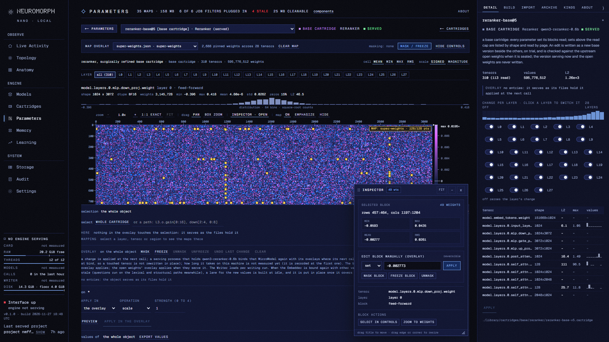

*Coordinate-level functional mapping: whole-tensor BF16 heatmap of `model.layers.0.mlp.down_proj.weight` (`3,145,728` weights, `15%` zeros) with `128/128` pinned `super-weights.json` coordinates overlaid in gold, the floating Parameter Inspector open on a selected 49-weight block (`rows 457:464, cols 1197:1204`) with inline block editing, and per-layer `L0..L27` switches on the right.*

### 2. Whole-Set Parameter Viewer, Reversible Live Overlays & Direct Editing
Every parameter-holding object (**base cartridges**, **job filters**, **compensation/socket cartridges**, **adapters and project lenses**, **learning units**, **preference cartridges**, and **optional upstream open weights**) is governed by one unified inspection and editing engine (`nm-parameters/1`, `crates/nmcore/src/bin/pedit.rs`):

- **Chunk-streamed whole-set imaging:** Inspect every tensor grouped by layer and block (`attention`, `mlp`, `norm`, token table) via interactive heatmaps with signed (`diverging`) or magnitude (`sequential`) scales, index rulers, distributions, and `mean / min / max / rms` summaries. Regions stream in `<= 4 MiB` chunks so even the `151,669 x 1,024` token embedding matrix is never loaded whole into host RAM.
- **Map overlays on live tensors:** Project `super-weights.json` directly onto heatmaps as gold `[row, col]` coordinate pins, or highlight layer coverage from job filters and OWL maps, with `on / emphasize / hide` visual controls.
- **Floating, movable, resizable Parameter Inspector:** Click any individual weight or multi-weight block to inspect exact stored values, coordinates, tensor percentile, and paired parameter-map readings; double-click any cell or block to open and focus manual inline editing directly.
- **Addressable coordinate operations with norm-diff previews:** Target `*`, whole layers (`L<n>`), individual tensors, rows, columns, channels, attention heads, or `[r0:r1, c0:c1]` blocks with `set`, `add`, `mul`, `scale`, `clamp`, `zero`, `identity`, `negate`, `paste`, `import`, `export`, `copy`, `interpolate`, `blend`, `drop`, `add_point`, and truncated-SVD `rank` reduction. Every operation computes a dry-run diff (`changed` count, L2 norm delta, max delta, sampled old vs new values) before writing.
- **Reversible live overlays & per-layer controls:** Like reversible functional silencing during surgical mapping, every **edit**, **mask** (exact residual identity pass), or **freeze** (read-only protection lock) can be applied in a live overlay (`memory/overlays/`) without modifying the underlying cartridge or open-weight files, or written as a new trial version beside the source. Engineers can toggle individual MicroModel layers on or off directly from the **Models** page or inside the Parameter Viewer. Every change is audited with one-click Undo and shares identical parity across the UI, MCP (`nm_cartridges`), HTTP API, and CLI.

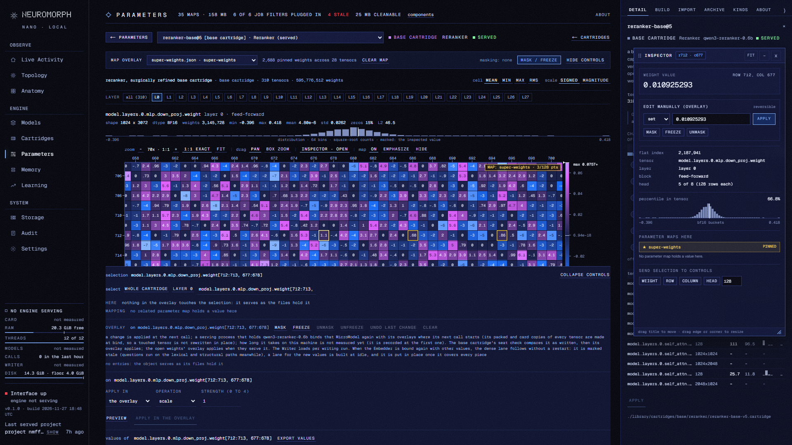

*Zoomed-in `1:1 EXACT` (`70x`) view of `model.layers.0.mlp.down_proj.weight`: individual BF16 parameters rendered as square cells with numeric values, three gold-outlined pinned super-weights visible across row 712 (`3/128 pts`), and the floating Parameter Inspector locked on `row 712, col 677` showing `★ super-weights · PINNED`, exact value (`0.010925293`), tensor percentile (`66.8%`), and inline reversible overlay editing (`set`, `mask`, `freeze`, `unmask`).*

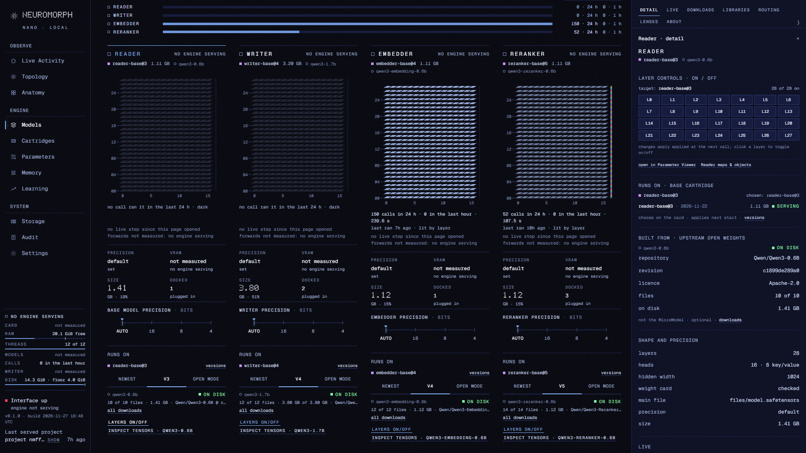

*Per-layer controls (`L0..L27`): toggle any MicroModel layer on or off through the reversible parameter overlay directly beside live layer activity and base-cartridge controls.*

---

## Complete Feature Set

| Subsystem | Engineering Capabilities | Control Surface |
|---|---|---|
| **Symbiotic Codebase Recall & 4-Level World Model** | Parallel Neuropod foraging across source code, Markdown, PDFs, CSV/TSV, JSON/YAML/HTML/XML, logs, and zip/tar/Office containers; multi-stage Core Brain (`G0 -> G1 -> G2 -> G3`) returning cited context packs within token budgets and withholding unsupported answers; idle Writer generating `L1 Piece -> L2 File -> L3 Module -> L4 System` notes while yielding to interactive calls in `< 300 ms`. | MCP (`nm_context_pack`, `nm_repo_map`, `nm_symbol_find`, `nm_deps`, `nm_view`, `nm_sync`), UI |
| **Modular Parameter Cartridges & Anti-Forgetting Stacking** | Gavriel Technologies architecture separating fixed MicroModel assemblies from modular weight cartridges; deterministic runtime stacking (`base -> hardware -> adapters/lenses -> job filters -> learned units -> preferences`) with unmerged application, `f64`-folded affine sockets, compartment isolation, instant swap without restart, and bit-identical rollback when unplugged. | UI (**Cartridges**), MCP (`nm_cartridges`), API, CLI |
| **Precision Parameter Mapping, Surgery & Live Overlays** | Wanda + OWL per-weight functional mapping, pinned `super-weights.json` coordinates, bidirectional pruning and surgical add-back, `bmq8.cu` bitmask-sparse GPU execution, chunk-streamed whole-set heatmaps, floating movable/resizable Inspector, per-layer on/off switches, and reversible `edit / mask / freeze` overlays. | UI (**Parameters**, **Models**), MCP (`nm_cartridges`), API, CLI |
| **Continuous Learning, Evidence Ledger & Distillation** | Closed-loop session evidence ledger tracking cited reads, edits, build/test outcomes, and reverts; split-gate validation with atomic rollback snapshots; curated and live teacher distillation (`adapter`, `filter`, `readout`, `unit`) with license provenance; dynamic dense-index following that automatically rebuilds project vectors at idle whenever Embedder weights or overlays change. | UI (**Learning**, **Audit**), MCP (`nm_learning`, `nm_feedback`, `nm_unit`), API, CLI |
| **Stated Preference Cartridges** | Natural-language preference parser supporting 5 languages (English, Spanish, French, German, Portuguese): enforced text transformations, checked code/style rules, bounded logit-bias wanted terms with per-rule strength (`0.1-2.0`), and scoped style guidance (global, project, file extension, or folder), always plugged last in the stack. | UI (**Learning -> Preferences**), MCP (`nm_learning`), API, CLI |
| **Agent Guidance, Priming & Build Verification** | Claude Code hook integration delivering verified primes at prompts, edits, test failures, and compactions; stop-hook completion loops (`check-passes`, `goal-done`, `steps-done`, `all-of`, `any-of`, with stall and tool/time budgets); error-repeat reminders; dependency step graphs; offline Cargo build help, Step Check, and improvement scanning (`nm_build_run`, `nm_build_explain`, `nm_stepcheck`, `nm_verify`, `nm_improve_scan`, `nm_patch_propose`). | UI (**Memory -> Loops & graph**), MCP (`nm_goal`, `nm_build_*`, `nm_verify`, `nm_stepcheck`), Hooks, CLI |
| **Hugging Face Cartridge Libraries & Download Manager** | Built-in public official library (`gavriel-tech/neuromorph-nano-cartridges`, no token required) + third-party Hugging Face sources; floating movable/resizable **HF downloads** window covering base cartridges, job filters, parameter maps, shared stacks, and optional open weights with category/role/search filters, explicit what-it-maps descriptions, `archived/` hiding, SHA-256 verification, two-step delete, and confirmation-gated **Publish to Hugging Face** (`source_publish`). | UI (**Cartridges**, **Models**, **Parameters**), MCP (`nm_settings`), API |
| **Zero-Dependency Runtime, Hardware Scaling & Privacy** | 21 `std`-only Rust crates (`unsafe` confined to `nmffi`), 12 prebuilt multi-arch CUDA fatbins (`sm_75`-`sm_90` + PTX) with AVX2/FMA/F16C CPU fallback, per-card `dp4a` auto-tuner, multi-session loopback engine sharing, idle KV-cache release, hard VRAM/RAM/CPU/memory-area caps (`content`, `caches`, `weights`), user-owned backup/restore repositories, opt-in paired LAN tablet access, and verifiable one-switch Air-Gap Mode. | Engine, UI (**Settings**, **Storage**), MCP (`nm_settings`, `nm_storage`, `nm_status`, `nm_live`) |

---

## Release Status, Hardware, and System Requirements

**`v0.1.01` is the current public prototype release of Neuromorph Nano** (Windows 10/11 x64), built on a 4 GB GPU. It ships the complete end-to-end local organism: zero-dependency Rust runtime, 12 custom multi-arch CUDA fatbins, four coexisting MicroModels seated on base cartridges with dynamic VRAM/RAM scaling, 25 MCP tools, parameter mapping and cartridge surgery, public Hugging Face parameter-map/filter downloads and opt-in publishing, continuous learning primitives, and the 11-page local observability interface. Formal cross-hardware benchmark reports will be published as the platform matures beyond this initial prototype.

### System Requirements (`v0.1.01`)

| Component | Requirement |
|---|---|
| **Operating System** | Windows 10 / 11 (x64). Native Linux x64 and macOS (Apple Silicon) support are next on the roadmap. |
| **GPU (Recommended)** | NVIDIA Turing or newer (`sm_75`+: GTX 16xx, RTX 20xx-50xx; adapts automatically to your GPU's available VRAM) with a current NVIDIA display driver. No CUDA Toolkit install required. |
| **CPU Fallback** | Any x86-64 processor with AVX2, FMA, and F16C when no usable NVIDIA GPU is present. |
| **Host RAM** | 16 GB+ recommended (user-configurable hard caps via `limits.ram_mb` and per-area memory budgets). |
| **Disk Space** | About 7 GB free for the four SHA-256-verified base cartridges (about 6.5 GB) and tokenizer/config JSONs (about 44 MB). Add about 8 GB if you also install the optional upstream open weights for fallback, reference checks, parameter mapping, or surgery. |

### Hardware Compatibility & Adaptation

- **Zero-config multi-architecture CUDA:** All 12 custom CUDA fatbins ship prebuilt across **7 targets** (`sm_75` Turing, `sm_80`/`sm_86` Ampere, `sm_89` Ada Lovelace, `sm_90` Hopper SASS, plus `compute_75` and `compute_90` PTX for forward JIT on newer GPUs).
- **Per-chip auto-tuning:** On first run, `nmengn::autotune` benchmarks the four bit-identical `dp4a` tile kernels on your GPU in under 100 ms and caches the fastest pair in `memory/machine.json`.
- **Dynamic residency & memory areas:** VRAM ceilings, KV-window reserves, host-weight offloading, and per-area memory budgets (`content`, `caches`, `weights`) adapt automatically to your hardware and obey hard user limits.
- **Automatic CPU fallback:** Machines without an NVIDIA GPU or with an older driver automatically fall back to the pure-Rust processor path (AVX2, FMA, F16C) and report the active path in the CLI, UI, and MCP status.

---

## Quickstart

### Option 1: Windows Installer (x64)

```powershell
irm https://raw.githubusercontent.com/gavriel-tech/neuromorph-nano/main/tools/install.ps1 | iex
```

The installer downloads the release zip and `SHA256SUMS.txt` from GitHub Releases, checks the zip's SHA-256, installs into `%LOCALAPPDATA%\NeuromorphNano` and adds `bin\` to your user `PATH`. It then fetches the four base cartridges (about 6.5 GB, from the official cartridge library) plus the small tokenizer/config JSONs (about 44 MB) so Neuromorph Nano runs standalone immediately. Pass `-WithOpenWeights` (or use **Models -> Downloads** in the interface) if you also want the optional upstream open weights (about 8 GB) for fallback, reference parity checks, parameter mapping, or surgery. Every file is checked against its SHA-256 before it is placed, and a partial download resumes.

Installing on an offline or air-gapped machine? Copy the release zip, `SHA256SUMS.txt`, the models and the cartridges over once, then run:

```powershell
.\tools\install.ps1 -LocalZip .\neuromorph-nano-v0.1.01-win-x64.zip -ModelsFrom E:\nano\weights -CartridgesFrom E:\nano\library
```

### Option 2: Build From Source (Windows 11 x64)

Requires Rust `1.99.1` (MSVC, selected by `rust-toolchain.toml`) and Node.js `20.9+` (only to build the static interface). The CUDA toolkit is needed only if you edit the `.cu` kernels.

```powershell
cargo build --release
cd interface; npm ci; npm run build; cd ..
```

The program is `target\release\neuromorph-nano.exe`. A source build does not download models or cartridges; get them from the interface (Models and Cartridges pages) or run the installer. See [docs/user-guide.md](docs/user-guide.md) and [CONTRIBUTING.md](CONTRIBUTING.md).

### Connect Your Coding Agent (One Command)

`neuromorph-nano connect` writes the MCP entry for one client and keeps every other server's entry. Add `--dry-run` first to see the exact difference it would make:

```powershell
# Pick your client: claude | cursor | vscode | antigravity | windsurf | generic
neuromorph-nano connect claude --project C:\path\to\your\repo

# Open the local interface at http://127.0.0.1:4870/
neuromorph-nano launch ui
```

`generic` prints the command line and JSON for any other stdio MCP client. Each call's audit row records the name the client gives when it connects, and Live Activity lists every coding agent's calls. The 25 tools are listed in [docs/mcp-tools.md](docs/mcp-tools.md).

---

## The Local Interface

`neuromorph-nano launch ui` serves the interface at `http://127.0.0.1:4870/`. Every page has the same frame: the page list on the left, the working system in the middle (live visuals and their controls), and a right side panel with the page's collections, references and an About tab, which also shows the detail of whatever you pick in the middle.

| Group | Pages |
|---|---|
| **Observe** | **Live Activity** (`/`): every coding agent's calls, the organism at work (zoom and pan), stage times. **Topology**: ganglion stages, tentacles, base and learned cartridges. **Anatomy**: every part, its card and what it depends on. |
| **Engine** | **Models**: the four MicroModels, what each runs on, per-layer on/off switches, base cartridge choice, routing, the floating **HF downloads** window, and Hugging Face library browsing, `fetch all`, and opt-in publishing. **Cartridges**: one deck per MicroModel with its base cartridge seated and its cartridges docked to plug, unplug, inspect parameters or change version; the floating **HF downloads** manager (browse everything Hugging Face offers, check items to download, or safely delete downloaded items), plus the cartridge library, base versions, Downloads, Sources, and learned units in the side panel. **Parameters**: the map atlas and universal Parameter Viewer (clickable layer bars, base cartridges and filters, paired parameter-map overlays, floating movable/resizable Inspector with inline manual overlay editing, floating **HF downloads**, and the 4-step Build panel), with each map's lineage, archive and restore. **Memory**: memory tiers, the world model and recall. **Learning**: learning cycles and rollback, the evidence ledger and the training data. |
| **System** | **Storage**: disk use by category, with safe pruning. **Audit**: every call and change, with inline question show/hide and undo. **Settings**: every control, project drive storage summary, hardware limits and Air-Gap Mode. |

The interface shows measured data only; a figure that was not measured is named as not measured. Every feature is also reachable through MCP and the local JSON API ([docs/interface-api.md](docs/interface-api.md)), and deleting anything goes through a preview and more than one confirmation step.

### Screenshots

Captured at 1920x1080 during live MCP calls against a real repository, started the way Claude Code starts it. All four MicroModels are held on the card, a context pack is running and the Embedder is executing; every lit part and every figure is a live reading of that run.

| | |
|---|---|
| 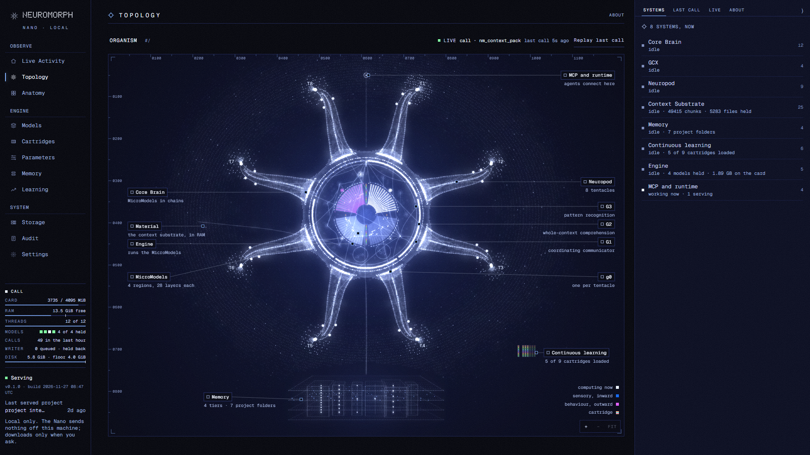 **Topology**: the organism's systems, each with its state now. | 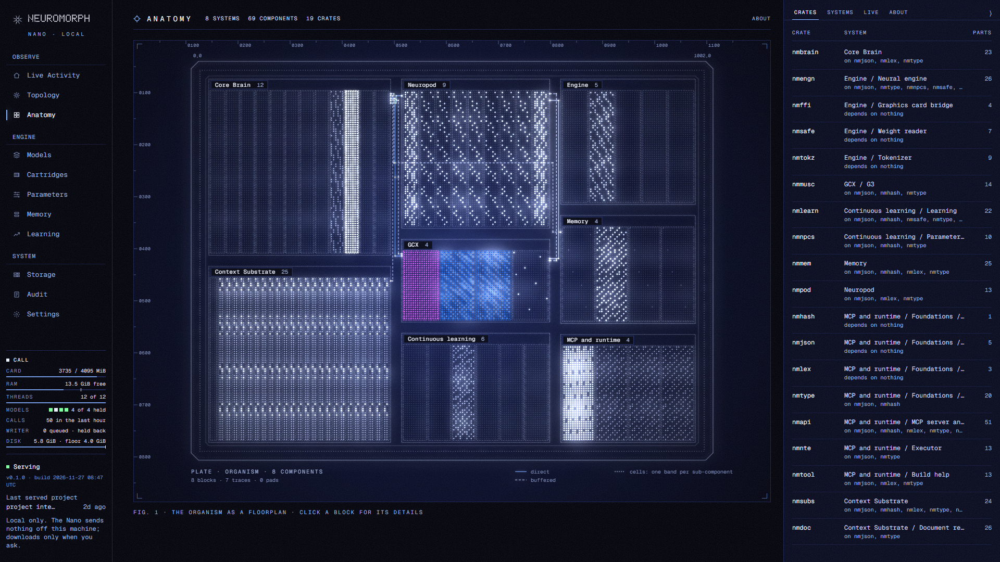 **Anatomy**: every part and the crate that holds it. |
| 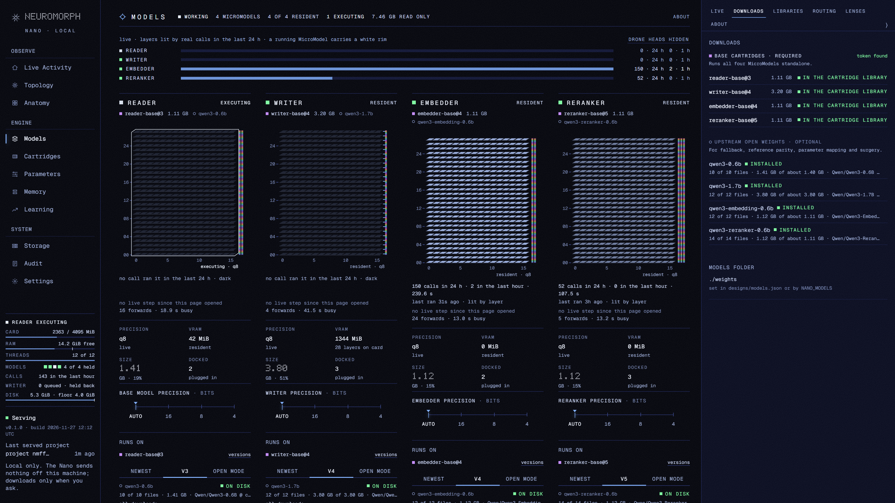 **Models**: the four MicroModels, each on the card with its layers lit by real calls. | 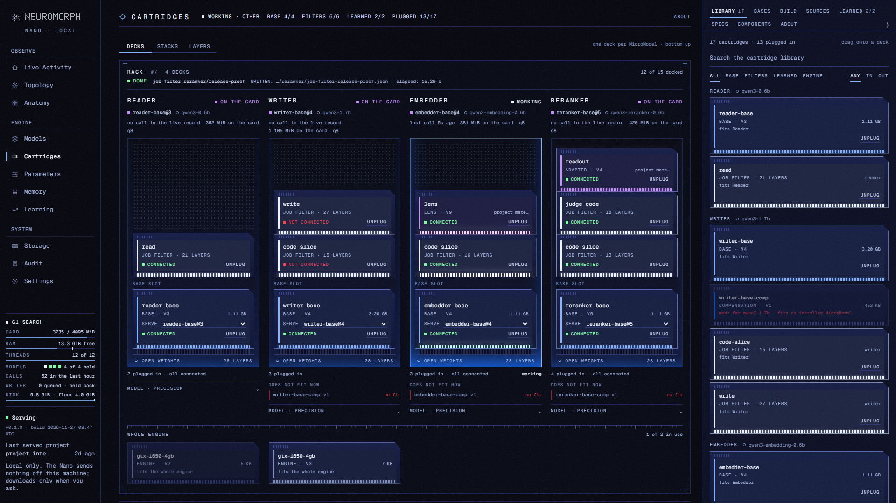 **Cartridges**: one deck per MicroModel, base seated, cartridges docked. |
| 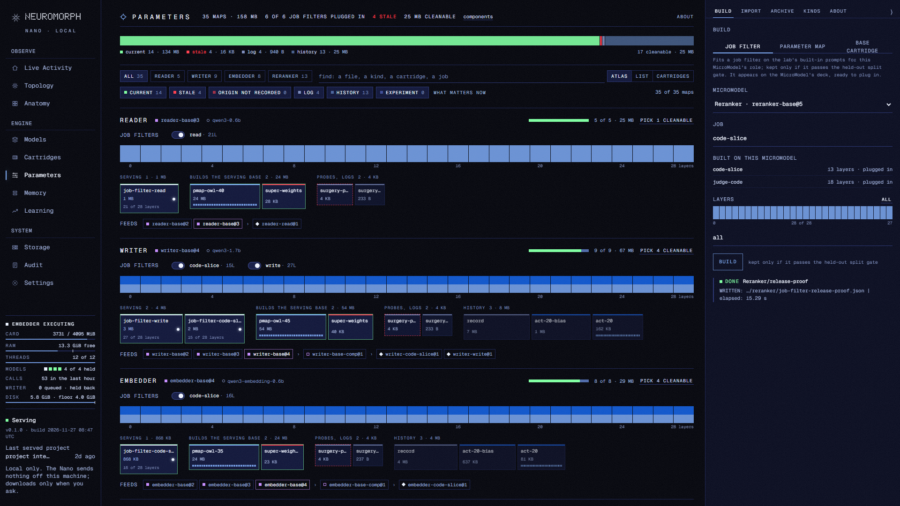 **Parameters**: the map atlas and the cartridge parameters. | 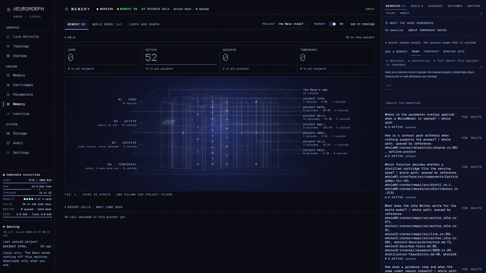 **Memory**: tiers as strata, one column per project. |
| 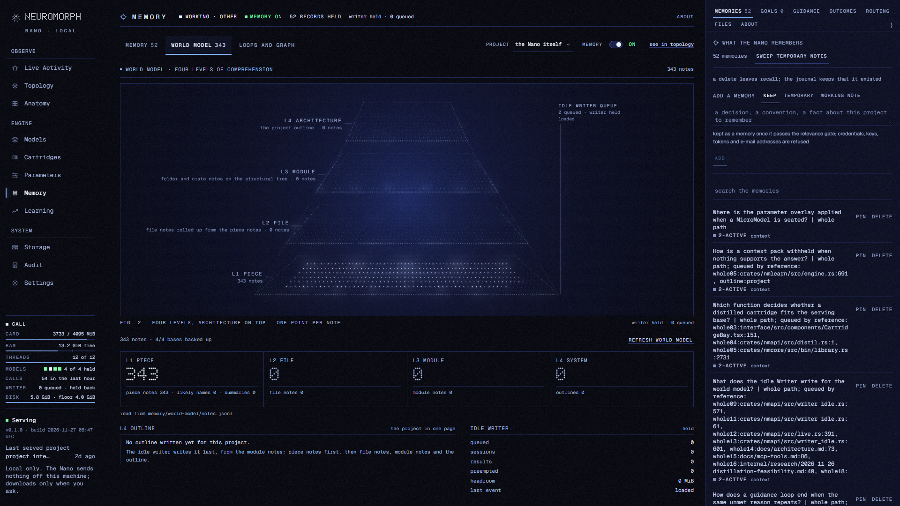 **World model**: the four levels the idle Writer builds. | 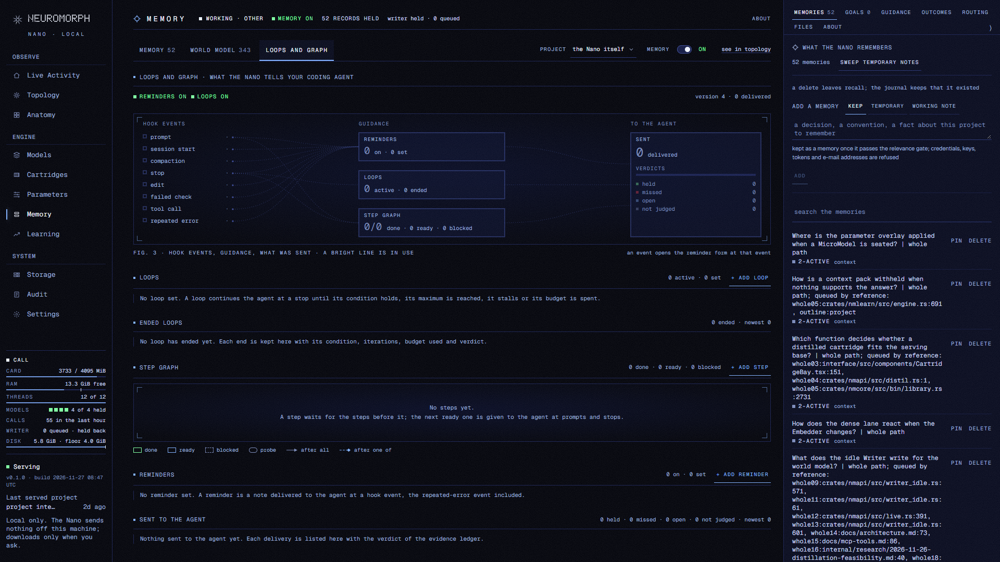 **Loops and graph**: the guidance circuit for your coding agent. |
| 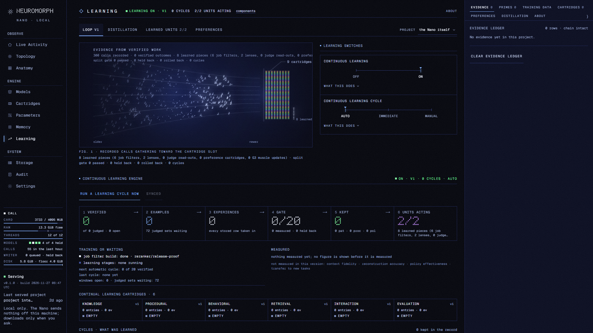 **Learning**: the learning loop, distillation, learned units and preferences. | 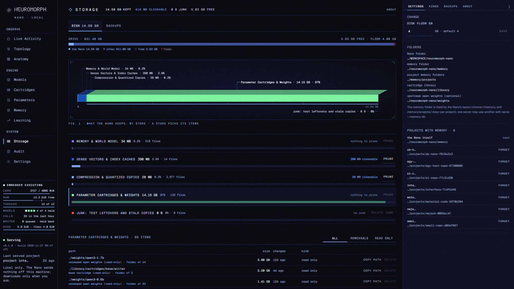 **Storage**: disk use by category and your backup repositories. |
| 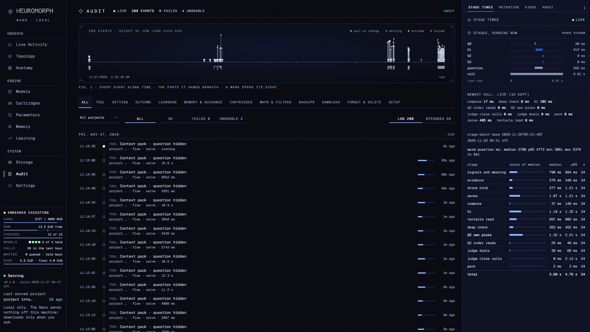 **Audit**: every call and change along time, with undo. | 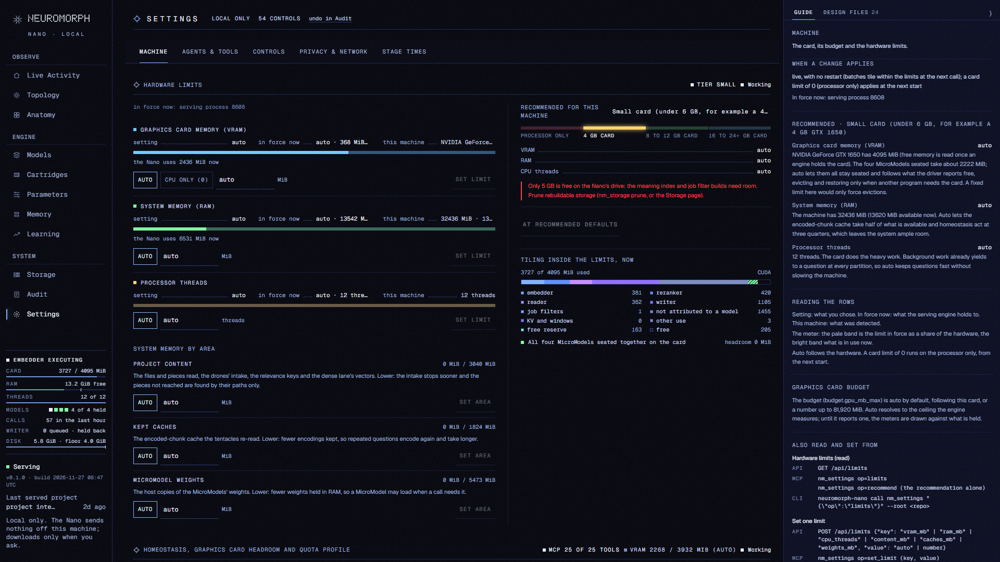 **Settings**: every control, hardware limits and memory areas. |

### Cartridge Libraries

The official cartridge library is on Hugging Face at [`gavriel-tech/neuromorph-nano-cartridges`](https://huggingface.co/gavriel-tech/neuromorph-nano-cartridges) (public, no token required). You can also add third-party Hugging Face libraries as cartridge sources, or publish your own job filters, parameter maps, and non-base cartridge stacks directly to your own Hugging Face repository (or as a Pull Request to the official library) via **Publish to Hugging Face** (`source_publish`). Nothing is fetched or uploaded until you ask; everything fetched goes through the same checks as the cartridge library on this machine (stacks arrive on trial, an existing map is never replaced, base cartridges come from the official library only, and decommissioned files under `archived/` are hidden from the downloader). See [docs/cartridges-and-parameters.md](docs/cartridges-and-parameters.md) and [docs/build-flow.md](docs/build-flow.md).

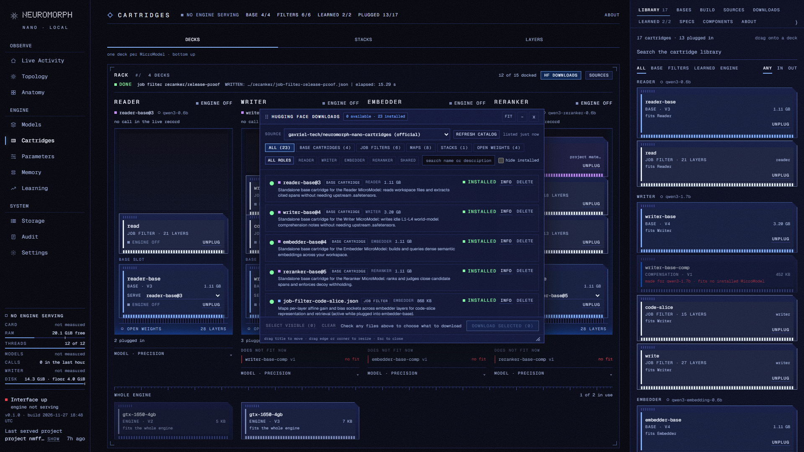

*The floating Hugging Face Download Manager: inspect everything in `gavriel-tech/neuromorph-nano-cartridges` (base cartridges, job filters, parameter maps, shared stacks, and optional open weights) with explicit descriptions, category/role filters, multi-select downloads, and safe two-step deletion.*

---

## Field Guide: Explore the Organism

Every folder in this repository corresponds to a layer of the organism. Because the Rust workspace uses **only the Rust standard library (`std`)**, you can read any crate end to end without chasing dependency trees.

<details>
<summary><strong>The 21 Rust Crates (Grouped by Organ System)</strong></summary>

| Organ System | Crates | What to Explore |
|---|---|---|
| **Sensory & Neuropod** | [`nmdoc`](crates/nmdoc/), [`nmlex`](crates/nmlex/), [`nmsubs`](crates/nmsubs/), [`nmpod`](crates/nmpod/) | Code lexers for many languages, PDF, Office and archive readers, the Global Context Substrate, parallel tentacles, and `RowCache` drones |
| **Core Brain & Nervous System** | [`nmbrain`](crates/nmbrain/), [`nmnte`](crates/nmnte/), [`nmmem`](crates/nmmem/), [`nmmusc`](crates/nmmusc/) | Ganglion stages (`G0-G3`), the executor, tiered memory (`core/active/archive`), and muscle memory |
| **Neural Engine & Custom CUDA** | [`nmengn`](crates/nmengn/), [`nmffi`](crates/nmffi/), [`nmsafe`](crates/nmsafe/), [`nmtokz`](crates/nmtokz/) | Safetensors reading, the Qwen3 BPE tokenizer, the 4-model residency manager, the per-chip `dp4a` auto-tuner, idle KV release, and zero-VRAM speculative decoding |
| **Cartridges & Continuous Learning** | [`nmnpcs`](crates/nmnpcs/), [`nmlearn`](crates/nmlearn/) | Model cards and parameter maps, `nmengn-sockets/1` job filters, lenses, preference cartridges, learned units, and split-gate verification |
| **MCP, Build Help & Foundations** | [`nmapi`](crates/nmapi/), [`nmcore`](crates/nmcore/), [`nmtool`](crates/nmtool/), [`nmtype`](crates/nmtype/), [`nmjson`](crates/nmjson/), [`nmhash`](crates/nmhash/), [`nmlab`](crates/nmlab/) | The 25 MCP tools and the interface parity layer, the `neuromorph-nano` program and interface server, the `nmtype::class` sensory boundary, Cargo build help and Step Check, and the `nano-lab` measurement tool |

</details>

<details>
<summary><strong>The 25 MCP Tools & Documentation (<code>docs/</code>)</strong></summary>

Every user-facing capability works the same in the interface and over MCP: `nm_context_pack`, `nm_repo_map`, `nm_symbol_find`, `nm_deps`, `nm_view`, `nm_sync`, `nm_memory`, `nm_feedback`, `nm_goal`, `nm_unit`, `nm_build_run`, `nm_build_explain`, `nm_improve_scan`, `nm_patch_propose`, `nm_verify`, `nm_stepcheck`, `nm_status`, `nm_anatomy`, `nm_weights`, `nm_live`, `nm_storage`, `nm_cartridges`, `nm_learning`, `nm_comprehension` and `nm_settings`. All 25 tools are advertised by default over `tools/list` and can be filtered through the `mcp.*` settings.

- [Architecture](docs/architecture.md) · [User Guide](docs/user-guide.md) · [MCP Tools Reference](docs/mcp-tools.md)
- [Cartridges & Parameters](docs/cartridges-and-parameters.md) · [Build Flow](docs/build-flow.md) · [Continuous Learning](docs/continuous-learning.md)
- [Agents and models](docs/agents.md) · [Configuration](docs/configuration.md) · [Interface API](docs/interface-api.md) · [Privacy](docs/privacy.md)
- The full index is [docs/README.md](docs/README.md).

</details>

---

## Privacy, Air-Gap, and User Control

- **The Nano sends nothing off your machine on its own:** The engine sends no telemetry and makes no network request of its own. Your coding agent is separate: the context the Nano hands it goes to the agent's model like any file the agent reads (with a cloud model, to its provider); run a local model behind your agent for nothing to leave at all (see [Agents and models](docs/agents.md)). The MCP server talks to your agent over standard input and output; the interface binds `127.0.0.1`. The only outbound requests are downloads, library listings, and confirmation-gated **Publish to Hugging Face** uploads you explicitly trigger (models, base cartridges, parameter maps, job filters, stacks), made over Windows' native HTTPS (WinHTTP, with `curl.exe` fallback) with every downloaded file verified against its SHA-256.
- **Verifiable Air-Gap Mode:** Turn on **Air-Gap Mode** in Settings, over MCP (`nm_settings op=set key=air_gap value=on`), or lock it for the process with `$env:NANO_AIR_GAP = "on"`. Air-Gap Mode keeps the interface on `127.0.0.1`, turns off local network access and tablet pairing, and refuses every download and remote listing. `GET /api/airgap` and `nm_settings op=airgap` show its state live.
- **Hardware limiters:** Cap GPU VRAM (`limits.vram_mb`), host RAM (`limits.ram_mb`) or background threads (`limits.cpu_threads`) in Settings or over MCP, or apply the recommended values detected for your hardware in one click.
- **Transparent storage:** See the exact paths and sizes of memory, dense vectors, quantized copies and cartridges in Storage or `nm_storage`, and prune rebuildable caches whenever you want.
- **Your code stays your code:** What the Nano reads from your repository is held in RAM and never written to disk; the audit log never holds file contents.

See [docs/privacy.md](docs/privacy.md) and [SECURITY.md](SECURITY.md) for the full statement.

---

## Repository Layout

| Path | Contents |
|---|---|
| [`crates/`](crates/) | The 21 Rust crates (standard library only; `unsafe` forbidden everywhere except the two FFI modules of `nmffi`) |
| [`kernels/`](kernels/) | CUDA kernel sources and the 12 prebuilt multi-arch `.fatbin` files |
| [`designs/`](designs/) | The design files the engine reads: anatomy, memory policy, models, chains, the serving base cartridges |
| [`interface/`](interface/) | The local interface (Next.js, TypeScript, static export) |
| [`docs/`](docs/) | Architecture, user guide, MCP and API reference, privacy, cartridges and learning |
| [`tools/`](tools/) | Installer (`install.ps1`), release packager, card and integrity sealing, and end-to-end verification |
| [`tests/`](tests/) | Engine reference recordings, development question sets and section-check fixtures |
| [`weights/`](weights/) | The cards of the upstream open weights (SHA-256 of each file); the weights themselves are downloaded, never committed |
| `rules.md`, `INTEGRITY.md` | The Nano's own rules and the SHA-256 integrity manifest |

*Runtime state (`memory/`, `runs/`, `library/`, `muscle/`, `units/`, `settings.json`, `cartridge-sources.json`, the downloaded model files, `bin/`, `scratch/`, `target/`) stays on your machine and out of git.*

---

## Frontier Roadmap & Open Collaboration

`v0.1.0` proves the core architecture end to end on Windows x64 (NVIDIA CUDA and CPU fallback). From here, we are pushing the frontier of local, modular cognitive systems and actively welcome collaborators who want to expand platform reach, hardware efficiency, and intelligence:

- **Cross-Platform Runtime & Hardware Backends:** Native Linux x64 (`libcuda.so.1` + POSIX `nmffi`), Apple Silicon ARM64 (NEON + native Metal GPU kernels), and AMD/Vulkan GPU acceleration, while preserving the zero-dependency `std`-only Rust core with all `unsafe` isolated in `nmffi`.
- **Dynamic Memory & Larger Local Models on Consumer Hardware:** Finer-grained dynamic weight placement, on-demand disk-mapped token tables, and running larger frontier local models comfortably inside modest VRAM/RAM budgets.
- **Parameter Surgery, Cartridges & Continual Learning:** Higher-throughput quantization, richer teacher distillation, automated parameter mapping, and community-contributed base cartridges, job filters, and lenses on Hugging Face.
- **Multi-Repository & Enterprise Workflows:** Shared local knowledge graphs, multi-repository orchestration, and commercial support.

If you build Rust systems, CUDA/Metal/Vulkan kernels, quantization passes, or parameter maps, read [CONTRIBUTING.md](CONTRIBUTING.md) and [CONTRIBUTOR_POOL.md](CONTRIBUTOR_POOL.md) to join the build.

---

## License and Copyright

Copyright (c) 2026 Luis Jake Gabriel III (Gavriel Technologies). All rights reserved.  
Designed by Luis Jake Gabriel III.

Neuromorph Nano is **source-available and non-commercial**. It is not open source. Personal, academic and other non-commercial use is free under the **PolyForm Noncommercial License 1.0.0** ([LICENSE](LICENSE)). Commercial use of any kind requires an individually negotiated commercial license from Luis Jake Gabriel III (Gavriel Technologies); only the copyright holder may offer Neuromorph Nano as a commercial product. See [COMMERCIAL.md](COMMERCIAL.md).

The official cartridge library ([`gavriel-tech/neuromorph-nano-cartridges`](https://huggingface.co/gavriel-tech/neuromorph-nano-cartridges)) is under the same PolyForm Noncommercial license. The upstream Qwen3 models it is built from are open weights by the Qwen team under the Apache License 2.0; their notices ship beside the library and are listed in [THIRD_PARTY_NOTICES.md](THIRD_PARTY_NOTICES.md).

Contributions are licensed as [CONTRIBUTING.md](CONTRIBUTING.md#contributor-licensing) says, and merged contributions are credited under [CONTRIBUTOR_POOL.md](CONTRIBUTOR_POOL.md) (the Neuromorph Nano-only 55% / 30% / 15% contribution reward distribution system). Questions: `gavriel.techno@gmail.com`.
