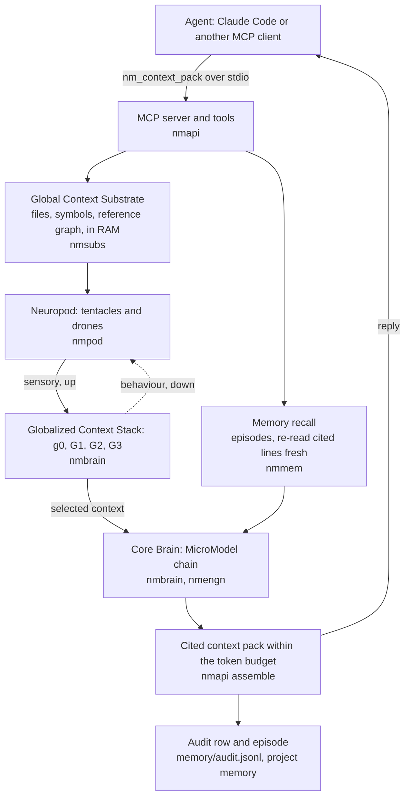

# Architecture

Neuromorph Nano is a digital organism: intelligence is spread across cooperating parts, not one
large model active for every operation. It has a body and a nervous system. This page describes
its parts, how a question flows through them, the engine crates, the interface, and where memory
and settings live.

## The digital organism

The organism's anatomy is data: `designs/anatomy.json` lists every part and connection, and the
interface's Topology and Anatomy pages draw it from there.

**Sensory and behavioural data are kept apart.** Sensory data is what is read: the studied material
(code, documents, notes, tables, logs) and its content. Behavioural data is the organism's own
internal communication: instructions, controlled reflexes, reports and requests. Sensory data
travels up; behaviour travels down.

**Global Context Substrate (GCS).** The studied folder as the organism holds it: files, each read
into one document model (derived text and blocks: headings, paragraphs, lists, tables, records,
log events, code items), symbols, crates and the reference graph of real relations between pieces
(definitions, calls, imports), with views over them. Documents are cut at their own sections and
blocks; code keeps its line windows. A format table (`nmdoc`) decides which reader reads a file.
PDF has its own reader: it opens the file in memory (cross-reference tables and streams, object
streams, filters, empty-password encryption), runs each page's content stream with its fonts
mapped to characters, and rebuilds words, lines and paragraphs in reading order (by the tagged
structure when there is one, else by geometry with columns); every block carries its page. A file
no specific reader fits is read generally: a container (zip, gzip, tar; Office, EPUB and
OpenDocument files are zips of XML) is opened in memory, nothing extracted to disk, and each member
is read by the reader that fits it and located as `container!member`; anything else gives the runs
of readable text in its bytes (UTF-8, UTF-16, Latin-1), each located by its byte offset, under a
header naming what the file is by its first bytes. Such files are marked as read generally. Only
what holds nothing to read or must not be read is skipped and counted with its reason. Code is read
through a language table (`nmlex::lang`): one generic lexer drops comments and strings for each
language, and one generic tagger finds definitions (name, kind, first and last line, enclosing
class) and imports. Rust keeps its own scanner. Entries are thin (comment and string forms,
definition words, block style); code in a language without an entry is read through a
language-neutral entry (common comment and string forms, common definition words, blocks by braces
or by indentation), so no code file is skipped for its language. A code window outside Rust carries
the nearest definition as its heading. Imports are resolved to files of the tree (relative paths,
`tsconfig.json` paths, npm workspaces, Python import roots, C include folders); `package.json` and
`pyproject.toml` give packages next to Cargo's crates. In a folder that is not a Neuromorph folder,
files its `.gitignore` leaves out are skipped. In **every** folder (including Neuromorph folders),
root and nested `.nanoignore` files exclude matching files and folders from the substrate, dense
index, fresh recall re-reads, build-help source snippets, and primes (`docs/privacy.md`, Excluding
files with `.nanoignore`). Reads live in RAM while the material is unchanged
and are redone when it changes. With memory on, the read is also cached in the project's memory
folder (the substrate cache, `substrate-cache-<12 hex>.bin`, keyed by every file's path, size and
time) so that a restart on an unchanged folder does not read everything again; any change makes the
cache unused. What it holds: `docs/privacy.md`, Your code.

**Neuropod.** The sensory side.
- Tentacles: eight (`global`, `local`, `structural`, `semantic`, `temporal`, `operational`, `epistemic`, `objective` defaults, all configured with `"job": "any"` so any tentacle can dynamically take any role or lens per question). Each tentacle is a small brain that processes its own disjoint 12,000-token window (96,000 tokens in parallel at default) while sharing central MicroModel weights by reference rather than owning weights. On a large tree they take in specific, spread-out pieces connected by real relations rather than reading everything blindly.
- Drones (dendrites): the dendrites at the tip of each tentacle, the first contact with the raw material (`crates/nmapi/src/drone_dendrite.rs`, on by default). They run a truncated early-layer cut (`layers 0..k`) of the Reader MicroModel by reference, compute ColBERT-style `MaxSim` late interaction and request-to-piece layer-`k` attention in RAM with position-0 attention-sink exclusion and sensory adaptation (posed-minus-content-free background baselines), classify evidence, and judge confidence. Drones of different tentacles never exchange data.

**Globalized Context Stack (GCX).** The spinal cord or brain stem. It carries afferent sensory data up and efferent motor control orders down (`nmbrain::motor`), and every level is held in RAM.
- `g0` (`g0_tx`, one per tentacle): holds its tentacle's encoded read on a shared scale, cancels predictable background fields via Huber residualisation (electric-fish negative image), and executes fast local spinal reflexes (`R1-R5`) installed by `G2`.
- `G1`, coordinating communicator: receives every tentacle's output and is the only path between tentacles, integrating evidence with fading accumulators and an independence quorum (honeybee quorum model).
- `G2`, whole-context comprehension: decides what goes up to the Core Brain and sends instructions and reflex rules down, such as directing a tentacle's focus.
- `G3`, pattern recognition: recognises repeated behaviour and its effect, refuses self-caused patterns (immune negative selection) and sensory data (`nmmusc-sensory-refused`), promotes statistically verified habits (Stitch-style compression + Welch `z = 1.96` gate) into `.nmmusc` muscle-memory packs, withdraws fading habits via Page's CUSUM, and reloads active packs back to `G2`.

**Core Brain.** Singular: one brain whose regions are MicroModels (parameter sets are its neurons), alongside its `Objectives`, `Rivers`, `Arbiter`, `Contradiction`, `Homeostasis` (interactive latency budget), `Development`, and `Synthesis` parts. It works as one: one orchestration, one arbitration, one output. A request runs through a chain of MicroModels; the final output is kept separate from internal logs.

**MicroModels.** The MicroModels are named by their role:

| MicroModel | Its job | Built from (upstream open weights) |
|---|---|---|
| Reader | The drones' and tentacles' reads and the judge's reads | Qwen3-0.6B |
| Writer | The idle notes of the world model | Qwen3-1.7B |
| Embedder | The meaning lane (dense recall) | Qwen3-Embedding-0.6B |
| Reranker | The judge: orders the candidates | Qwen3-Reranker-0.6B |

Each runs on its Neuromorph base cartridge, built from those upstream open weights (the Qwen3 open
weights, Apache-2.0). The serving version of each base cartridge is listed in
`designs/base-cartridges.json`. The open weights are never altered: they are read only, the
reference the cartridges are measured against, and the fallback (open mode, a MicroModel with no
base cartridge seated). They must be installed: each MicroModel reads its tokenizer and
configuration from them, and a base cartridge is seated only after a check run that compares its
outputs with theirs, after which the open weights are released from memory and the card. Which
installed model serves a role can be changed from the next start
(Models page, `/api/models/roles`, kept as `role_models` in `settings.json`); the Reader is locked,
because its drones read attention heads mapped for one model. Each MicroModel runs at the
precision set for it: the engine's own width by default, or 16, 8 or 4 bits by setting
(`docs/configuration.md`).

**Cartridges.** A cartridge is stackable parameters that load onto a MicroModel's blocks, labelled
with what it does, which MicroModel and base it was made for, and its measured effect. Besides the
base cartridges there are job filters cut from parameter maps, learned and preference cartridges,
project adapters, and settings cartridges for one graphics card. Cartridges stack on a base
cartridge or on the open weights, in order, and are refused on a base they were not made for.
Cartridges come from the official Neuromorph library on Hugging Face
(`gavriel-tech/neuromorph-nano-cartridges`) and from any third-party Hugging Face library you add;
nothing is fetched until you ask. Details: `docs/cartridges-and-parameters.md`.

**Learning.** Learning is its own system, apart from memory: judged outcomes become experiences, and
a learning cycle keeps patterns, procedures and policies only when they predict held-out outcomes
better than before. What is kept acts as learned units, each plugged in or out by compartment (a
project, or shared). Details: `docs/continuous-learning.md`.

**Muscle memory.** When a behaviour that improves results recurs at G3, it is compressed, labelled
and saved to disk as a pack. Behaviour only, never sensory data. It is its own store: not memory,
not weights, not a cartridge.

**Memory.** Persistent records in a hierarchy (`1-core`, `2-active`, `3-archive`) with synaptic tag-and-capture temporary notes (`T0`), RAM working memory (`T1`), append-only verified episodes (`T2`), per-version structural summaries (`T3`), a strict write gate (`refused.jsonl`), the world model's 4-level notes, and the **Dead-Skin Biomimetic Vector Store** (`dense/vectors.bin`, `seg-*.bin`, `skin.json`; see [`docs/dead-skin-vectors.md`](dead-skin-vectors.md)). See Memory layout below.

## How a question flows

1. The agent calls `nm_context_pack` with a question and a token budget.
2. The organism draws candidates from the substrate and from memory recall.
3. On the plain path the selection is made from the substrate's views and reference graph. With
   `serve --neural` the Embedder and Reranker take part; with `serve --whole` the question goes
   through drones, tentacles, the GCX and the Core Brain's reranker order and second look.
   With `serve --lenses on` (off by default) every drone signal reaches the tentacle's g0 as its
   own score, each of the eight tentacles composes its window by its own lens (the drone signals,
   the relations of the strongest finds, and memory), no piece is in two windows, and G1 compares
   the eight reports on one shared scale. `bench --mode stack` shows, per question, where the
   answer sits after the drones, in the windows, in each g0's report, in G1's order and in what G2
   sends up.
4. The reply is a cited pack: each span with its file and line range. When nothing is observed for
   the question, the pack is withheld rather than guessed.
5. The call is written to the audit log, with the name the connecting MCP client gave; with memory
   on, an episode is kept for later recall and for outcomes (`nm_feedback`, `nm_verify`). The
   reply goes first: before it, only the episode and its journal event are written (the records
   memory is rebuilt from); the hierarchy and the journal's views are written after it. A process
   that ends in between loses nothing: they are rebuilt at the next open.
6. Recall keeps the request's data and the material's apart: an earlier question is compared only
   with the new question, the lines an earlier answer cited are read fresh and compared with the
   new question on their own, and no judged input holds both.

## Engine crates

The engine is one Rust workspace, standard library only. `unsafe` code is forbidden in every crate
except `nmffi`.

| Crate | What it is |
|---|---|
| `nmhash` | SHA-256 |
| `nmjson` | Strict JSON reader and canonical encoder |
| `nmlex` | Token and term helpers, and the language table for code |
| `nmdoc` | Document readers: the format table, text encodings, document structure, PDF, containers and general reading |
| `nmtype` | Shared contracts: Context Packet, components, cards, folder and project paths, the MicroModel of each role |
| `nmnte` | The executor: anatomy graph, snapshots, scheduler, registry |
| `nmsubs` | Global Context Substrate and its views, the substrate cache and the dense index on disk |
| `nmpod` | Neuropod: tentacles, drone tips, territories |
| `nmbrain` | Core Brain and the GCX levels |
| `nmmem` | Memory system: hierarchy, tiers, temporary notes, write gate, identity, retention |
| `nmnpcs` | Model cards, parameter clusters and the parameter map |
| `nmengn` | Neural engine over the Qwen3 open weights: processor and graphics card, decode, adapters, engine reference |
| `nmffi` | The NVIDIA driver bridge and dynamic loading; the only crate with `unsafe` |
| `nmsafe` | Safetensors reading and quantization |
| `nmtokz` | Qwen3 byte-level BPE tokenizer |
| `nmlearn` | Learning: units, read-outs, cartridges, preferences, ledger, the continuous learning engine |
| `nmtool` | Build help, Step Check, improvement findings, conformance |
| `nmmusc` | G3 behaviour log and muscle memory packs |
| `nmapi` | The organism, the MCP server and its 25 tools |
| `nmcore` | The `neuromorph-nano` program: commands, interface server, controls, launcher |
| `nmlab` | The lab, inside the product as `neuromorph-nano lab` (also built as its own program `nano-lab`): the builders of parameter maps, base cartridges and job filters, benches, research harnesses and stage runs |

## The interface and its local API

`neuromorph-nano launch ui [--port <n>] [--dev]` serves the interface's static export
(`interface/out/`) and a JSON API on `127.0.0.1` (default port 4870). It is written with the
standard library only.

The pages, in three groups:

| Group | Pages |
|---|---|
| Observe | Live Activity (the start page), Topology, Anatomy |
| Engine | Models, Cartridges, Parameters, Memory, Learning |
| System | Storage, Audit, Settings |

Every page has the same three columns: the page list on the left; the working system in the
middle (its live figures, visuals and controls); and a side panel on the right with tabs for the
page's collections and references, the detail of whatever is picked in the middle, and About (what
the page is and how it works). The side panel folds away and is remembered per page; on a narrow
screen it slides over from the right. What each page shows: `docs/user-guide.md`, The interface.

The API serves the same reads and controls as the pages, and the MCP tools `nm_storage`,
`nm_cartridges`, `nm_learning`, `nm_comprehension`, `nm_settings` and `nm_live` call the same
functions. Every route with its fields is in `docs/interface-api.md`.

GET and HEAD read. A POST is accepted only with the server's local token in the `X-Nano-Token`
header, as JSON, and from the interface's own origin or a local program that sends no origin (403
otherwise). The token is made when the server starts, held in memory only, and placed in every HTML
page the server sends (`<meta name="nano-token">`). With `--dev`, the Next.js development server
(`http://localhost:3000`) is also accepted and reads the token from `GET /api/token`, which
otherwise answers 404. A request whose `Host` is not 127.0.0.1 or localhost gets 403, unless local
network access is on (the `network` control), in which case a paired tablet is served with its own
token (`X-Nano-Token` or the `nano_device` cookie). Other methods get 405. A path that climbs out
of `interface/out/` gets 404. A request that deletes something is confirmed in two steps: the first
answers with a preview and a single-use confirmation token, and only the same request sent again
with that token deletes.

## Memory layout

| Path | Contents |
|---|---|
| `memory/audit.jsonl` | One audit log for all projects; never holds file contents |
| `memory/projects/<name>-<8 hex>/` | One folder per studied repository, named by its folder name and a hash of its path |
| `.../project.json` | The repository's path, first and last use |
| `.../episodes.jsonl` | Verified outcomes, append only |
| `.../journal/` | The change journal: every memory and every change to it, the memory's record |
| `.../1-core/`, `2-active/<topic>/`, `3-archive/<topic>/`, `index.json` | Saved memory by tier, most used at the top, each memory in one tier; views written from the journal only; the archive is never deleted |
| `.../temp/captured.json` | Working notes captured at the end of a task, kept as temporary memories in the journal (view) |
| `.../hierarchy.json` | Use counts of saved items by level (uses, useful uses, failed re-reads) |
| `.../temp/notes.json` | Temporary notes: used on three run-days (days the system ran) saves one, seven run-days unused clears it |
| `.../migrated/` | A copy of the memory files as they were, kept once when a folder in an older layout is brought to the current one |
| `.../structural/` | One summary per code version |
| `.../refused.jsonl`, `outcomes.jsonl`, `decisions.jsonl`, `snapshot.json`, `undo.json`, `rundays.json` | Bookkeeping of the memory system: refused writes, outcomes, decisions, a start-up copy of the journal's state, the changes that can be undone, the run-days |
| `.../world-model/` | The world model's notes, written by the Writer at idle |
| `.../substrate-cache-<12 hex>.bin`, `dense/`, `meaning/` | Caches: the read of the folder, the meaning index, the recall meaning cache |
| `.../situation.jsonl`, `prompts.jsonl`, `evidence.jsonl`, `primes/` | What the hooks recorded, kept prompt text, the evidence ledger, the primes given per session |
| `.../training/`, `continual/`, `learned/` | The training store, the continuous learning engine's state, learned units |
| `.../setup/` | What `setup` created in the repository, and backup copies of the files it changed |

What each of these keeps, and how to clear it: `docs/privacy.md`.

Each memory file has one writer. The journal's views (the tier folders, `index.json`,
`temp/captured.json`, `undo.json`, `snapshot.json`) are written from the journal and nothing
else; `hierarchy.json` belongs to the use counts and `temp/notes.json` to the temporary notes. A
folder written by an older version, where the use counts and the journal shared the tier files,
is brought over when it is opened: the use counts move to `hierarchy.json`, the tier files are
written again from the journal, and a copy of the old files goes to `migrated/`. The Nano's own
folder (`memory/` at the top level) has the same layout; muscle memory packs are in `muscle/`,
outside the memory system.

Memory policy (tiers, lifetimes in run-days, the write gate) is in `designs/memory.json`. No memory
store has a count or size limit: working memory lasts one task, saved memory is kept and dropped by
its lifetimes, and nothing is removed for size.

## Where settings live

- `settings.json` in the Nano folder: your controls, written by the interface, and the choices made
  on its pages (the base cartridge version and the model of each MicroModel role). See
  `docs/configuration.md`.
- `designs/*.json`: data the engine runs on, such as `models.json` (models folder),
  `base-cartridges.json` (the serving base cartridges), `memory.json`, `muscle.json`, `chains.json`,
  `anatomy.json`.
- `library/`: the cartridge library and the parameter map library (base cartridges, parameter maps and job filters, stacks), and
  `cartridge-sources.json`: the cartridge libraries you added.
- `units/plugs.json`: which learned units are plugged in, by compartment.
- Command-line flags of `serve`, which win over saved controls.
